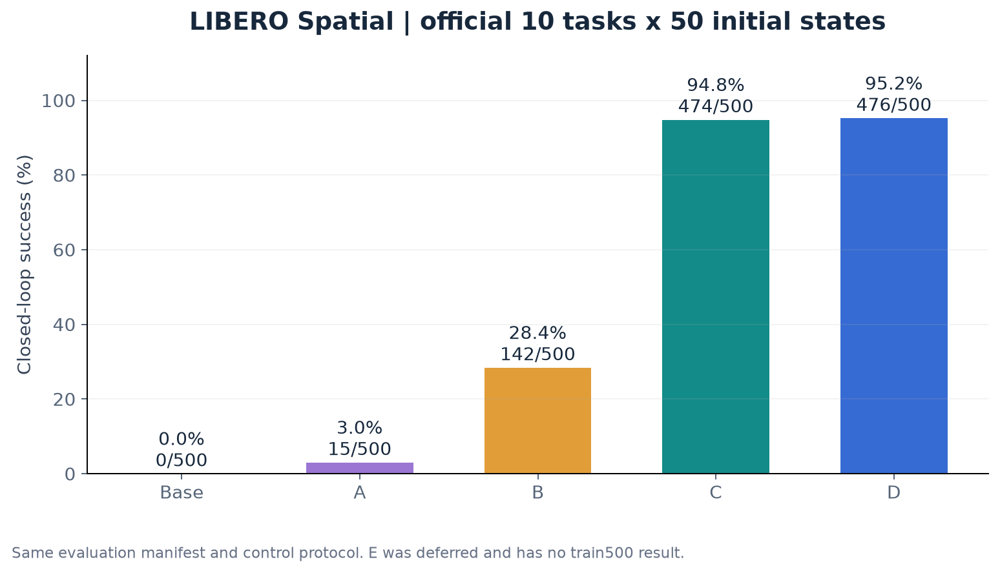
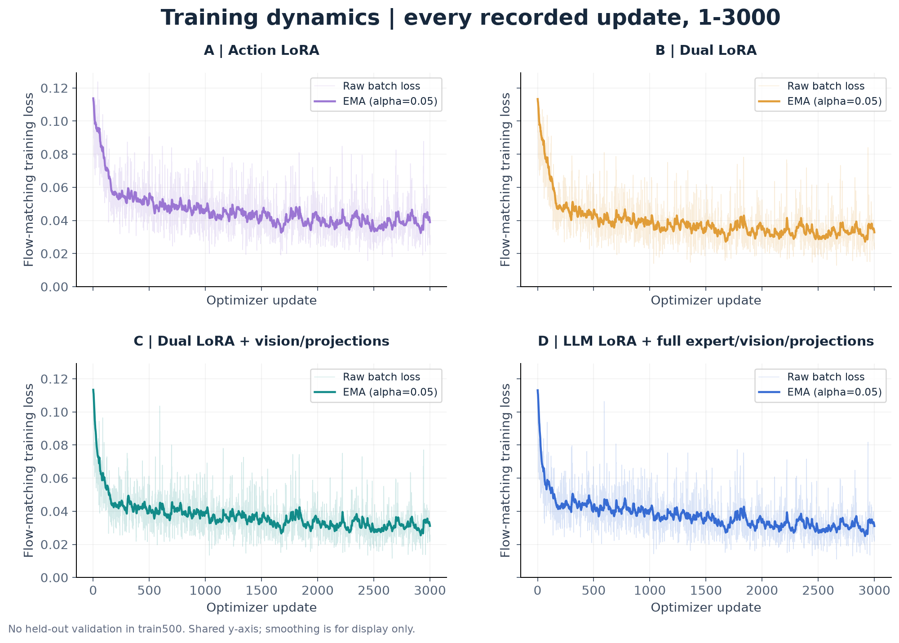

# π0.5 VLA Adaptation Lab

**预训练 VLA 应该更新哪些模块，才能学会具体操作任务？**

基于 OpenPI，在 LIBERO Spatial 上完成示教转换、模块微调、恢复训练与配对闭环评估。这个仓库汇集实际业务源码、12,000 次更新记录、2,500 回合结果、训练图表和真实仿真回放。

**500 条训练示教 · 61,750 帧 · 3,000 次更新 / 方案 · 官方 10 任务 × 50 初态 / 模型**

[交互 Demo](demo/index.html) · [60 秒概览视频](demo/overview.mp4) · [学习与面试手册](demo/study.html) · [结果分析](docs/results.md) · [复现说明](docs/reproduction.md) · [数据与模型机制](docs/methodology.md)

> 仓库保持 private。GitHub 文件预览不会执行 HTML；克隆后双击 `demo/index.html`，或按下面命令启动本地预览。未部署公网服务。



## 本轮结果

2026-11-01 完成；五组各 500 个唯一回合、每任务 50 回合，清单一致，errors=0，退出码=0。

| 方案 | 更新范围 | 可训练参数 | 成功回合 | 成功率 |
|---|---|---:|---:|---:|
| Base | 未微调的 π0.5 base | 0 | 0/500 | 0.0% |
| A | 动作专家 LoRA | 22,118,400 | 15/500 | 3.0% |
| B / Strict | 语言模块 + 动作专家 LoRA | 49,987,584 | 142/500 | 28.4% |
| C / Default | 双 LoRA + 视觉与外部投影等模块更新 | 466,957,072 | 474/500 | **94.8%** |
| D | 语言模块 LoRA + 视觉、外部投影、动作专家原权重更新 | 872,771,344 | 476/500 | **95.2%** |

E 整模型微调在本轮暂缓，没有 train500 结果。C 不是整模型全量微调。

### 三个值得讨论的结果

- **适配范围：**B→C 提高 66.4 个百分点；配对结果中 C 独有成功 335 回合，B 独有成功 3 回合。范围与存储精度联动，不能把全部收益严格归因于视觉模块。
- **参数取舍：**C 的可训练参数为 D 的约 53.5%，闭环成绩相差 0.4 个百分点。这里比较的是可训练参数数目，不等同于显存、耗时或推理速度收益。
- **平均分之外：**C、D 共同成功 460 回合，C 独有成功 14，D 独有成功 16，共同失败 10；需要查看同初态行为，不能只凭均分断言 D 普遍更好。

## 训练过程也可以检查



全部图表从既有日志生成，没有重新训练或补跑评估。交互页面支持方案开关、原始/EMA 曲线、逐步读数和 checkpoint 定位。提供九类图表的 PNG 与可导出 SVG：loss 原始波动、loss 趋势、学习率/梯度、末段 loss/观测耗时、成功率、逐任务热力图、参数/效果、配对成败、450/500 配方对照。

本轮无留出离线验证。Step 3000 的 loss 是该次更新的批次损失，最后 100/300 步均值也是更新批次均值，均不称作 validation loss。

| 方案 | Step 3000 批次 loss | 最后 100 步平均 |
|---|---:|---:|
| A | 0.025352 | 0.039685 |
| B | 0.022542 | 0.033571 |
| C | 0.022152 | 0.031552 |
| D | 0.021850 | 0.031307 |

## 查看 Demo，不需要 GPU

```bash
git clone git@github.com:DJH200202/pi05-vla-adaptation-lab.git
cd pi05-vla-adaptation-lab
python3 -m http.server 8768 --bind 127.0.0.1
# 浏览器打开 http://127.0.0.1:8768/demo/
```

也可以直接打开 `demo/index.html`；页面不依赖 CDN 或在线 API。包含 14 段原始双相机录像、起始图与动作 NPZ，覆盖成功、失败和 C/D 互有胜负的配对案例。播放的是策略在环境中实际执行的记录，不是示教动作重放，也不伪装为在线推理。

## 代码与工作范围

OpenPI 提供模型架构、预训练权重与原生变换；LIBERO 提供任务、示教与仿真环境。本项目围绕其构建了数据对齐与采样、模块更新范围、可恢复训练及配对评测，未从头预训练 π0.5。

| 入口 | 本项目负责的内容 |
|---|---|
| `scripts/convert_spatial_500.py` | HDF5 转换、时间对齐、全500训练数据版本与统计 |
| `src/pi05/dataset.py` | episode 内动作块、变换、采样与 batch |
| `src/pi05/model.py` | 模型初始化、LoRA 配置、参数筛选与前向解释 |
| `src/pi05/train.py` | 多卡更新、梯度累积、日志和已有验证模式 |
| `src/pi05/checkpoints.py` | 权重、优化器、随机状态和采样游标保存恢复 |
| `src/pi05/evaluate.py` | 官方初态闭环执行、配对噪声、录像/trace 与汇总 |
| `scripts/build_demo_data.py` / `plot_results.py` | 从现有记录生成展示数据与图表，不运行模型 |

本仓库业务源文件是服务器完成实验时的快照，哈希见 [provenance.json](results/provenance.json)。这个展示仓库的提交不是训练时的原始 Git 提交。完整数据、权重与环境未上传；GPU 仿真需要先配置这些资产，详见复现说明。

## 结果边界与历史版本

- 主结果只使用 `pi05-train500-ae-20261031T233628`：500 条训练、全500统计、无离线留出验证。
- [旧 450 条训练结果](results/train450/summary.csv)使用同一官方500回合协议，但数据与归一化不同；旧 E=91.4% 仅在历史表出现。
- 原来的 heldout50、400回合和432条数据版本不混入本轮。
- 同任务官方初态评估不等于未见任务泛化或真机能力；没有将官方适配权重的成绩作为本人结果。
- 原始配置保留 seed 等全部细节，不声称重复训练稳定性；更新范围和部分参数精度同时变化。

## 来源

- [OpenPI](https://github.com/Physical-Intelligence/openpi)，固定 `215abfb217dbac7d5f1273282331b9b1866c0479`。
- [LIBERO](https://github.com/Lifelong-Robot-Learning/LIBERO)，固定 `f78abd68ee283de9f9be3c8f7e2a9ad60246e95c`。
- [原始 LIBERO 数据](https://huggingface.co/datasets/yifengzhu-hf/LIBERO-datasets)。来源、许可和项目工作范围见 [THIRD_PARTY.md](THIRD_PARTY.md)。
